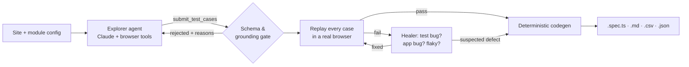

# AI Test Case Agent

An autonomous agent that **explores a web module in a real browser, designs test cases like a senior SDET, proves
them by replaying them, self-heals the broken ones, flags suspected product defects**, and ships the result as
Playwright specs plus manual test cases (Markdown and TestRail-style CSV).

Built with **Claude (tool use)**, **Playwright** and **TypeScript**. It needs no runtime dependencies beyond
`@playwright/test`.

```text
$ npm run demo
>>> [demo-shop/login] exploring with …
INF turn 2: browser_click {"ref":"e4"}                   ← agent triggers validation errors itself
INF turn 9: submit_test_cases
WRN Rejected — ungrounded locators: TC-LOGIN-001 step 6: testId "welcome-banner" was never observed
INF turn 10: submit_test_cases
 OK Agent submitted 8 test cases after 10 turns
WRN TC-LOGIN-005 failed at step 5: expect(locator).toContainText(expected) failed
INF TC-LOGIN-005 healer decision: fix — Expected text did not match the real message; updated to 'This account is locked' …
 OK TC-LOGIN-005 healed
...
WRN TC-PRODUCTS-005 failed at step 3: Expected [product-price] sorted number desc, got: ["$49.99","$4.99","$34.00",…]
INF TC-PRODUCTS-005 healer decision: defect — 'Price (high to low)' orders prices as strings: $4.99 appears right after $49.99 …
 OK demo-shop/products: 8 cases — validated 7, healed 0, suspected defects 1, quarantined 0
```

That run is fully offline. The bundled demo shop has a **deliberately seeded sorting bug**, and the pipeline finds it
and reports it as a suspected defect. It does not rewrite the test to pass.

---

## How it works



1. **Explore.** Claude drives Playwright through tools (`browser_snapshot`, `browser_click`, `browser_fill`, …). Each
   snapshot is a compact list of elements with implicit ARIA roles, accessible names and the *most stable
   locator* (testId → role+name → label → placeholder). The agent deliberately triggers negative paths so it sees
   real error messages.
2. **Design.** The agent submits test cases as **structured JSON in a typed step DSL**, which is not free-form code.
   Each case has an objective, type, priority, test-design technique, preconditions and assertions.
3. **Gate.** Submissions are schema-validated and **grounding-checked**: any locator the agent never observed is
   rejected with the exact step and reason, and the agent corrects it.
4. **Validate.** Every case is replayed in a fresh browser context using the *same* action definitions that generate
   the spec.
5. **Heal or flag.** On failure, Claude gets the error and a snapshot of the page at the point of failure, and must
   choose to fix the test (without weakening its intent), flag a suspected defect, or drop the case.
6. **Generate.** Deterministic generators produce a Playwright spec (tags, annotations, `test.fail()` for
   suspected defects, `test.fixme()` for quarantined cases), a Markdown test-case document, a CSV for test
   management import, and the JSON system of record.

See [docs/ARCHITECTURE.md](docs/ARCHITECTURE.md) for the design decisions and how this scales.

## What's in the repo

```
src/
  agent/        explorer loop, tools, grounding guardrail, prompts
  browser/      Playwright session + page snapshot (refs, roles, stable locators)
  llm/          Claude Messages API client (prompt caching, retries) + record/replay cassettes
  model/        test-case types, JSON Schema, validator
  steps/        DSL actions: exec (browser) · emit (code) · narrate (manual step)
  validate/     replayer + self-healer
  generators/   Playwright spec, Markdown, CSV, site index
sites/          one config file per target application (saucedemo, demo-shop)
demo-site/      Mini Mart, a small offline shop with a seeded bug
fixtures/replay recorded LLM turns for offline runs / CI
generated/      output: per site → per module
tests/          framework self-tests (schema, grounding, codegen, agent loop, healing)
```

## Quick start

```bash
git clone https://github.com/<you>/ai-testcase-agent.git && cd ai-testcase-agent
npm install
npx playwright install chromium

npm run demo              # full agent pipeline offline, no API key (replayed LLM turns)
npm run test:demo-shop    # run the specs it just generated
npm test                  # framework self-tests
```

### Live run against SauceDemo with Claude

```bash
cp .env.example .env      # add ANTHROPIC_API_KEY
npm run agent -- generate --site saucedemo --module login
npm run agent -- generate --site saucedemo --module all --record   # also saves a replay cassette
npm run test:saucedemo
```

| CLI option | |
|---|---|
| `generate --site <s> --module <m\|all>` | explore → validate → heal → write outputs |
| `render --site <s>` | re-render spec/md/csv from an edited `test-cases.json` (schema-checked) |
| `list` | sites and modules |
| `--llm anthropic\|replay` | live Claude or recorded cassette |
| `--record` | save live responses as a cassette |
| `--no-validate`, `--heal <n>`, `--max-turns <n>`, `--headed` | tuning |

`ANTHROPIC_MODEL` overrides the model (default `claude-sonnet-5`).

## Sample output

`generated/demo-shop/products/products.spec.ts` (excerpt):

```ts
test('TC-PRODUCTS-005 Sort by price high to low', {
  tag: ['@P1', '@boundary', '@sorting'],
  annotation: [
    { type: 'objective', description: 'Numeric price sort descending; prices with different digit counts ($4.99 vs $49.99) expose string-vs-number sorting.' },
    { type: 'suspected-defect', description: '\'Price (high to low)\' orders prices as strings: $4.99 appears right after $49.99. Expected numeric descending order.' },
  ],
}, async ({ page }) => {
  // Suspected product defect — kept as an expected failure. Remove test.fail() once fixed.
  test.fail();
  // 1. Open /products.html
  await page.goto('/products.html');
  // 2. Select "price-desc" in [sort]
  await page.getByTestId('sort').selectOption('price-desc');
  // 3. [product-price] are sorted by value (descending)
  await expect(page.getByTestId('product-price').first()).toBeVisible();
  expect(isSorted(await page.getByTestId('product-price').allInnerTexts(), 'desc', 'number')).toBe(true);
});
```

Each module also gets a readable test-case document ([example](generated/demo-shop/login/test-cases.md)) and a
CSV ([example](generated/demo-shop/login/test-cases.csv)).

### About the included outputs

| Folder | How it was produced |
|---|---|
| `generated/demo-shop/` | Output of `npm run demo`: the real pipeline (browser exploration, grounding, validation, healing, codegen) driven by the reference transcripts in `fixtures/replay/demo-shop/`. CI regenerates it on every push. |
| `generated/saucedemo/` | A **reference test design** (33 cases across login, inventory, cart and checkout), rendered to specs by the same generators and marked *not-validated*. Run `generate --site saucedemo` with an API key to replace it with a live, browser-validated agent run. The CI job `saucedemo-suite` executes these specs against the live site. |

## Adding a new site

Create `sites/<name>.site.ts`, register it in `sites/index.ts`, and add a Playwright project if you want to run the
generated specs:

```ts
export default defineSite({
  name: 'my-app',
  baseUrl: 'https://my-app.example.com',
  description: 'What the app does, in one sentence.',
  testIdAttribute: 'data-test',
  testData: { user: { email: 'qa@example.com', password: '…' } },
  auth: { description: 'Log in as QA user', steps: [ /* DSL steps */ ] },
  modules: [
    { name: 'search', description: 'As a user I can search products…', entryPath: '/search',
      requiresAuth: true, focus: ['empty query', 'no results', 'pagination'], minCases: 5, maxCases: 10 },
  ],
});
```

## Guardrails and quality controls

- **Same-origin navigation only.** The agent cannot browse away from the application under test.
- **Schema-constrained tool input.** The same JSON Schema is sent to Claude and enforced locally.
- **Grounding check.** Locators must come from observed snapshots.
- **Replay validation.** Nothing is marked validated unless it passed in a real browser.
- **Defect-aware healing.** The healer can't just rewrite a failing assertion to make it pass.
- **Turn budget and context hygiene.** Old snapshots are elided, repeated elements are collapsed, and the system
  prompt and tools use prompt caching.
- **Reproducibility.** Record/replay cassettes and deterministic codegen keep runs stable.

## Roadmap

- Crawl navigation to propose modules automatically
- API-layer test generation from observed network calls (`page.on('request')`)
- Accessibility checks (axe-core) as a first-class assertion type
- Page Object generation from the grounding index
- Parallel validation across browser contexts

## License

MIT © Satish Gullipalli
