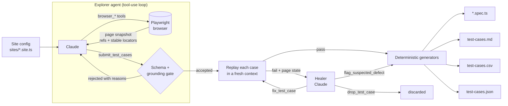

# Architecture

## Pipeline

## Components

| Path | Responsibility |
|---|---|
| `src/agent/explorer.ts` | ReAct loop: send context + tools to Claude, execute tool calls, feed results back, stop on accepted submission or turn budget. Elides old snapshots to keep the context window small. |
| `src/agent/tools.ts` | Tool definitions and handlers. Browser tools act on refs from the latest snapshot and return a fresh one. Same-origin guardrail on navigation. |
| `src/agent/grounding.ts` | Index of everything observed (testIds, role+name pairs, labels, placeholders, option values, visible text). Rejects locators the agent never saw. |
| `src/browser/snapshot.ts` | In-page DOM walk → compact element list with implicit ARIA roles, accessible names and the best stable locator per element. Repeated testIds are collapsed. |
| `src/model/` | Test-case types, the JSON Schema (shared by the Claude tool definition and our validator), and a dependency-free validator with LLM-friendly errors. |
| `src/steps/actions.ts` | One table defining every DSL action three ways: `exec` (live browser), `emit` (Playwright source), `narrate` (manual step). Exhaustive by type. |
| `src/validate/` | Replays test cases exactly as the spec will run them; the healer triages failures (test bug vs app bug vs not automatable). |
| `src/generators/` | Pure functions from suite JSON → spec / Markdown / CSV / site index. |
| `src/llm/` | Provider interface, Claude Messages API client (prompt caching, retry with backoff), and record/replay cassettes. |

## Key design decisions

**Structured output instead of generated code.** Letting an LLM write Playwright code directly produces tests that
compile but reference elements that don't exist, use brittle selectors, or silently weaken assertions. Here the model
emits test cases in a typed DSL constrained by a JSON Schema. Code generation is deterministic, so the same JSON
always yields the same spec — reviewable in a diff, reproducible in CI.

**Grounding before execution.** Every locator must correspond to something observed in a snapshot. This is cheap
(a set lookup) and catches most hallucinations before any browser time is spent. The rejection message tells the
model exactly which step is wrong, so it self-corrects in one turn.

**Validate what you ship.** `exec` and `emit` live side by side for each action, so the replay that marks a case
"validated" runs the same semantics as the emitted Playwright test.

**Healing that distinguishes test bugs from product bugs.** An auto-healer that always "fixes" the test will happily
rewrite assertions to match broken behaviour. The healer must choose: fix the test (without weakening intent), flag
a suspected defect (kept as `test.fail()` with a rationale, so the suite documents the bug and turns red once it is
fixed), or drop the case.

**Record/replay for determinism.** Cassettes make the whole pipeline (browser, grounding, validation, healing,
codegen) runnable offline and in CI without an API key or model nondeterminism.

**Configuration over code for new sites.** A site is one TypeScript file: base URL, test data, auth steps, and
modules with a user-story description and focus areas (lightweight acceptance criteria).

## Scaling this up

- **Parallelism:** modules are independent; run `generate` per module across workers/CI shards. Validation already
  uses one browser context per case and could fan out across contexts.
- **Cost control:** prompt caching on system prompt + tools, snapshot elision, collapsed repeated elements, and a
  turn budget. Token usage is recorded per run in `test-cases.json` / `test-cases.md`.
- **Larger apps:** add a crawler that proposes modules from the sitemap/navigation, and persist the grounding index
  per module so incremental re-generation only explores what changed.
- **Test management:** the CSV columns map to TestRail/Xray/Zephyr importers; the JSON is the system of record.
